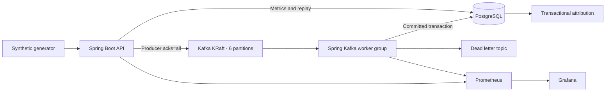
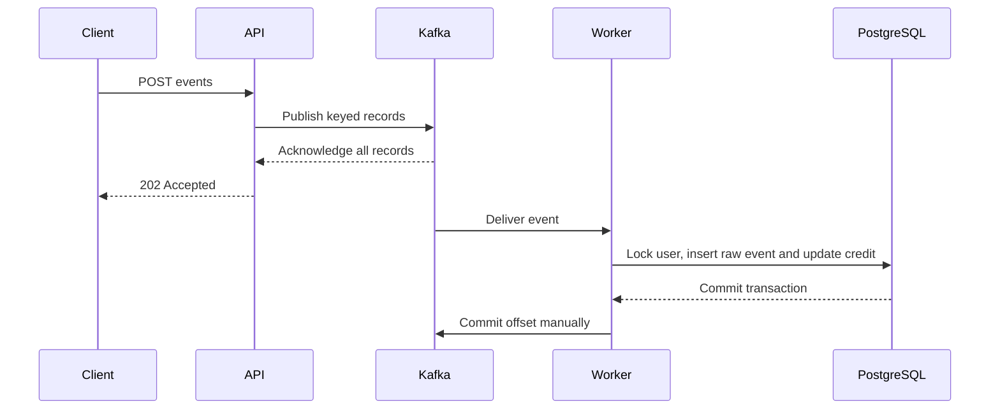

# Ads Event Attribution Pipeline

A Java backend portfolio project for measuring synthetic ad impressions, clicks and purchases. One Spring Boot image runs in separate API and worker processes. This is an independent project using generated data.

The Java pipeline is maintained independently; the original Python Lab is a separate project and remains unchanged. This portfolio emphasizes skills relevant to Ads Backend, Ads Infrastructure and Signal & Measurement roles. It demonstrates an event-driven measurement system, not a production ad-serving service.



## Five-minute local demo

Requirements: Docker Engine with Compose v2; Python 3.10+ for the synthetic generator; Java 21 and Maven for host-side builds/tests. The API and Grafana ports default to loopback on 8080 and 3000. Copy `.env.example` to `.env` only when changing local settings; set a unique `REPLAY_TOKEN` there to enable replay endpoints. The default stack uses generated data and a single Kafka broker.

```sh
cp -n .env.example .env
docker compose config --quiet
docker compose up --build --wait
python scripts/benchmark.py 1000 --run five-minute-demo
curl http://localhost:8080/api/v1/metrics/overview
curl http://localhost:8080/api/v1/attributions
curl http://localhost:8080/api/v1/health
```

Open `http://localhost:3000` (development credentials `admin/admin`) and select **Ads Attribution Pipeline** to inspect live metrics. The generator submits deterministic synthetic impressions, clicks and purchases; use a new run ID for each independent run. A single event can also be posted directly:

```sh
event_time="$(python -c 'from datetime import datetime, timezone; print(datetime.now(timezone.utc).isoformat())')"
curl --fail-with-body --silent --show-error \
  -H 'Content-Type: application/json' \
  -H 'X-Correlation-ID: demo-click-001' \
  --data-binary "{\"eventId\":\"00000000-0000-4000-8000-000000000001\",\"userId\":\"00000000-0000-4000-8000-000000000100\",\"type\":\"CLICK\",\"campaignId\":\"00000000-0000-4000-8000-000000000200\",\"adId\":\"00000000-0000-4000-8000-000000000300\",\"eventTime\":\"$event_time\",\"source\":\"five-minute-demo\"}" \
  http://localhost:8080/api/v1/events
```

HTTP 202 confirms Kafka acknowledged the event. Query `curl http://localhost:8080/api/v1/metrics/overview` or `curl http://localhost:8080/api/v1/metrics/campaigns` to inspect aggregate results. The first Compose build may take longer than five minutes on a cold machine.
Replace the example UUIDs when posting again to a stack whose database volumes were preserved.

Stop the stack and preserve its named volumes with:

```sh
docker compose down
```

To explicitly reset only this Compose project's demo data:

```sh
docker compose down --volumes
```

Actuator metrics are also available at `/actuator/prometheus`. Set `API_PORT` or `GRAFANA_PORT` in `.env` if a host port is occupied. Run host-side verification with `mvn -B verify`.

## Ingestion and consistency

Send camelCase JSON to `POST /api/v1/events` or an array to `POST /api/v1/events/batch`. All records require `eventId`, `userId`, `type`, `eventTime` in ISO 8601 and `source`. Touches require `campaignId` and `adId`. Conversions require `conversionId`, `conversionValue`, and `currency`. The API supplies `receivedAt`. Requests are capped at 256 KiB and 500 events per batch. The default limiter allows 100 requests per second per API process. The API returns 400 for invalid payloads, 413 for oversized requests, 429 for rate limits, and 503 when a broker acknowledgment cannot be confirmed. Responses echo an `X-Correlation-ID` propagated through Kafka headers and worker logs.

HTTP 202 means Kafka acknowledged every event in the request. A batch failure can leave a subset of records committed to the topic. Retry the complete batch with its original event IDs. Kafka partitions by synthetic user UUID, which orders logs per partition. Event-time order can differ from Kafka arrival order. The demo has replication factor one and therefore relies on one broker and its persistent volume.



The worker uses at-least-once delivery with idempotent PostgreSQL effects. A transaction holds a per-user advisory lock while writing the unique event ID and updating attribution; only after the transaction commits does the consumer acknowledge the Kafka offset. If the process fails after the database commit but before the offset commit, redelivery repeats the transaction safely. A transaction failure rolls back the ledger and attribution together and leaves the record available for retry. The raw ledger records processing timestamps and exposes them through the `event_processing_state` view.

The unique event ID preserves the first committed payload. Reusing an ID with a conflicting payload does not replace the original event or apply a second business effect. The unique conversion ID independently protects revenue from duplicate conversion records. Kafka retries transient processing errors. Invalid envelopes go to a dead-letter topic and are acknowledged after the DLQ write; a crash between that write and acknowledgment can duplicate a DLQ record.

## Attribution and late arrivals

Last touch first selects any eligible click within the previous 168 hours. If no click qualifies, it selects an eligible impression from the previous 24 hours. Both time boundaries are inclusive. Within the winning type, the latest event time wins, followed by descending UUID. Credit can move across campaigns. This is a documented portfolio model.

Every event has an event time, API receipt time and database processing time. A record is attribution-eligible when received no later than 48 hours after its event time. Late records remain in the ledger for audit, and late conversions are counted as unattributed. A conversion without a match starts pending and becomes unattributed after the receipt deadline. A qualifying touch can arrive in the consumer after that deadline if it was received at the API on time. The worker recalculates affected results using the same winner selection for both arrival orders. A revision increases only when the winning touch changes. Attribution results converge for the same eligible inputs with consistent IDs.

## Metrics and replay

Metrics routes include `/api/v1/metrics/overview`, `/api/v1/metrics/campaigns`, `/api/v1/metrics/campaigns/{campaignId}`, and `/api/v1/attributions`. Supply an inclusive `from` and exclusive `to`, plus `campaignId` where applicable. List endpoints support zero-based `page` and a `size` between 1 and 200. CTR is clicks divided by impressions. CVR is attributed conversions divided by clicks. Both ratios return zero with a zero denominator. Attributed revenue is a map from currency to decimal amount. The campaign_metrics view projects touch and conversion rows from the transactional tables, so changes in credit reach campaign counts and revenue together. Overall unattributed conversions include pending purchases. An attribution and its campaign totals use the purchase event timestamp, while touch counts use touch event timestamps.

A token-protected `POST /api/v1/replay/jobs?from=?&to=?&campaignId=?` snapshots committed database events and queues reconciliation. Read state, progress, correction count and logs at `GET /api/v1/replay/jobs/{id}`. Resume failed jobs with `POST /api/v1/replay/jobs/{id}/resume`. Send `Authorization: Bearer <REPLAY_TOKEN>`; replay endpoints return 404 when no token is configured. Each transaction advances the cursor alongside any versioned correction. An interrupted process can resume from the saved cursor. Live consumption and replay serialize credit updates per user. Kafka offset recovery and database reconciliation have independent cursors.

## Tests and benchmark procedure

`mvn -B verify` runs unit tests and Testcontainers integration tests against real Kafka and PostgreSQL containers with Flyway migrations. The suite covers real HTTP and Kafka messaging, duplicate and conflicting event IDs, concurrent duplicate deliveries, transaction rollback, late-event reattribution, deterministic ties, the database-commit/Kafka-offset boundary, malformed envelopes and replay. With the isolated Compose stack running, `python scripts/faults.py` stops and restores the worker, PostgreSQL and Kafka, then rewinds the demo consumer group to the earliest retained offset. Do not run that fault script against non-demo infrastructure.

Run the benchmark at 1,000, 10,000 and 100,000 events with unique run IDs. The Compose workflow compares one and three worker consumer threads against one API, one Kafka broker, one PostgreSQL instance and six partitions. Each run records Docker CPU/RAM, persisted throughput, API acknowledgment error rate, sampled commit lag and P50/P95/P99 from API receipt to database processing. That latency includes queue waiting and is not HTTP acknowledgment latency. Throughput measures the interval from the first request through observed persistence; the workflow does not separately report a drain-only interval. One trial per workload and a shared single-broker/database setup do not establish production capacity.

## Dependency security

The CI audit scans the CycloneDX SBOM generated from the same Maven build as the application JAR. It checks that the SBOM and Trivy package list are non-empty, confirms the vulnerability database loaded, retains the raw scan report and log, and fails on scanner errors or HIGH/CRITICAL findings. The current local scan of the patched graph found zero vulnerabilities across all severities; the final CI run and downloadable reports are tracked in [VERIFICATION.md](VERIFICATION.md).

## Stack and status

Java 21, Spring Boot 4.2.0, Spring Kafka, Kafka 3.9.1, Spring JDBC, PostgreSQL 17, Flyway, Maven, JUnit 5, Testcontainers 2.0.5, Docker Compose, Micrometer, Prometheus, Grafana and GitHub Actions. Maven resolves Spring Kafka, the PostgreSQL driver and other managed library versions from the Spring Boot 4.2.0 dependency management; the compression libraries are pinned to patched versions in `pom.xml`.

See [verification status](VERIFICATION.md) for the evidence matrix, CI/security artifacts and measured results. The local demo uses unauthenticated Kafka and a loopback HTTP API. Its replay endpoint is disabled by default. Offset durability after broker storage failure, production authentication, permanent quarantine remediation and multi-broker failover require deployment work.
