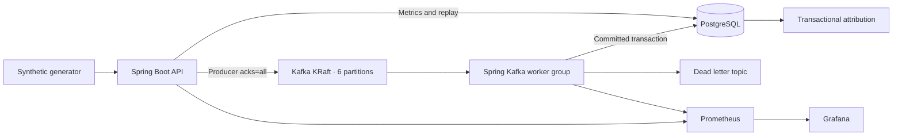
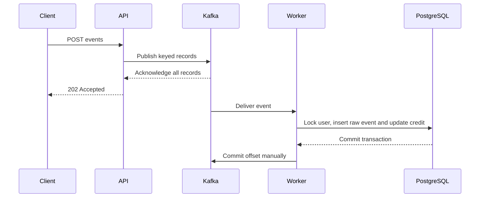

# Ads Event Attribution Pipeline

A Java backend portfolio project for measuring synthetic ad impressions, clicks and purchases. One Spring Boot image runs in separate API and worker processes. This is an independent project using generated data.



## Run locally

Requirements include Docker Engine with Compose v2, Python 3.10+ for the demo scripts, and Java 21 with Maven for host-side builds. Host ports 8080 and 3000 default to loopback. Set `API_PORT` and `GRAFANA_PORT` in a project-local `.env` if either port is occupied. Copy `.env.example` to enable local configuration. Set a unique `REPLAY_TOKEN` in that file to enable replay HTTP endpoints and export the same token in your shell to exercise them with the fault script.

```sh
docker compose config --quiet
docker compose up --build --wait
python scripts/benchmark.py 1000 --run demo-001
curl http://localhost:8080/api/v1/metrics/overview
curl http://localhost:8080/api/v1/attributions
curl http://localhost:8080/api/v1/health
mvn -B verify
docker compose down
# Optional, permanently removes only this Compose project's demo data.
docker compose down --volumes
```

Grafana opens at `http://localhost:3000` with the development defaults `admin/admin`. Open **Ads Attribution Pipeline** after generating traffic. Actuator metrics are also available at `/actuator/prometheus`. The generator uses namespaced UUIDv5 IDs and deterministic event sequences. Choose a fresh run ID for independent workloads.

## Ingestion and consistency

Send camelCase JSON to `POST /api/v1/events` or an array to `POST /api/v1/events/batch`. All records require `eventId`, `userId`, `type`, `eventTime` in ISO 8601 and `source`. Touches require `campaignId` and `adId`. Conversions require `conversionId`, `conversionValue`, and `currency`. The API supplies `receivedAt`. Requests are capped at 256 KiB and 500 events per batch. The default limiter allows 100 requests per second per API process. The API returns 400 for invalid payloads, 413 for oversized requests, 429 for rate limits, and 503 when a broker acknowledgment cannot be confirmed. Responses echo an `X-Correlation-ID` propagated through Kafka headers and worker logs.

HTTP 202 means Kafka acknowledged every event in the request. A batch failure can leave a subset of records committed to the topic. Retry the complete batch with its original event IDs. Kafka partitions by synthetic user UUID, which orders logs per partition. Event-time order can differ from Kafka arrival order. The demo has replication factor one and therefore relies on one broker and its persistent volume.



The worker uses at-least-once delivery with idempotent PostgreSQL effects. A transaction holds a per-user advisory lock while writing the unique event ID and updating attribution. The unique conversion ID independently protects business-level revenue. The first committed payload wins on ID reuse. Kafka retries on transient processing errors. Invalid envelopes go to a dead letter topic and are acknowledged after the DLQ write. A crash between the DLQ write and acknowledgment can duplicate a DLQ record.

## Attribution and late arrivals

Last touch first selects any eligible click within the previous 168 hours. If no click qualifies, it selects an eligible impression from the previous 24 hours. Both time boundaries are inclusive. Within the winning type, the latest event time wins, followed by descending UUID. Credit can move across campaigns. This is a documented portfolio model.

Every event has an event time, API receipt time and database processing time. A record is attribution-eligible when received no later than 48 hours after its event time. Late records remain in the ledger for audit, and late conversions are counted as unattributed. A conversion without a match starts pending and becomes unattributed after the receipt deadline. A qualifying touch can arrive in the consumer after that deadline if it was received at the API on time. The worker recalculates affected results using the same winner selection for both arrival orders. A revision increases only when the winning touch changes. Attribution results converge for the same eligible inputs with consistent IDs.

## Metrics and replay

Metrics routes include `/api/v1/metrics/overview`, `/api/v1/metrics/campaigns`, `/api/v1/metrics/campaigns/{campaignId}`, and `/api/v1/attributions`. Supply an inclusive `from` and exclusive `to`, plus `campaignId` where applicable. List endpoints support zero-based `page` and a `size` between 1 and 200. CTR is clicks divided by impressions. CVR is attributed conversions divided by clicks. Both ratios return zero with a zero denominator. Revenue is aggregated by currency. Overall unattributed conversions include pending purchases. An attribution and its campaign totals use the purchase event timestamp, while touch counts use touch event timestamps.

A token-protected `POST /api/v1/replay/jobs?from=…&to=…&campaignId=…` snapshots committed database events and queues reconciliation. Read state, progress, correction count and logs at `GET /api/v1/replay/jobs/{id}`. Resume failed jobs with `POST /api/v1/replay/jobs/{id}/resume`. Send `Authorization: Bearer <token>`. Each transaction advances the cursor alongside any versioned correction. An interrupted process can resume from the saved cursor. Live consumption and replay serialize credit updates per user. Kafka offset recovery and database reconciliation have independent cursors.

## Tests and benchmark procedure

`mvn verify` runs JUnit and Testcontainers with Apache Kafka 3.9.1, PostgreSQL 17 and Flyway migrations. The integration suite exercises real HTTP and Kafka messaging, both deduplication layers, delayed reattribution, deterministic ties, a simulated failure between the database write and Kafka acknowledgment, malformed envelopes, and replay. With Compose running, `python scripts/faults.py` stops and restores the project worker, PostgreSQL and Kafka.

Run the benchmark at 1,000, 10,000 and 100,000 events with unique run IDs. Recreate just the worker with `WORKER_CONCURRENCY=3` in the environment or `.env` to compare against the default of 1. Benchmarks record Docker CPU and RAM, persisted throughput, receipt-to-database P50/P95/P99, API acknowledgment error rate and periodic samples of committed lag. Consumer concurrency shares one broker, one database and six partitions. That limits scaling, and a producer-limited run may show little throughput change.

## Stack and status

Java 21, Spring Boot 3.5.16, Spring Kafka, Kafka 3.9.1, Spring JDBC, PostgreSQL 17, Flyway, Maven, JUnit 5, Testcontainers, Docker Compose, Micrometer, Prometheus, Grafana and GitHub Actions. Spring Boot 3.5.16 is the final public 3.5 patch. Later 3.5 security maintenance is commercial. See the [Spring release notice](https://spring.io/blog/2026/06/25/spring-boot-3-5-16-available-now/).

See [verification status](VERIFICATION.md) for commands executed and measured results. This local demo uses unauthenticated Kafka and a loopback HTTP API. Its replay endpoint is disabled by default. Offset durability after broker storage failure, production authentication, permanent quarantine remediation and multi-broker failover require deployment work.
